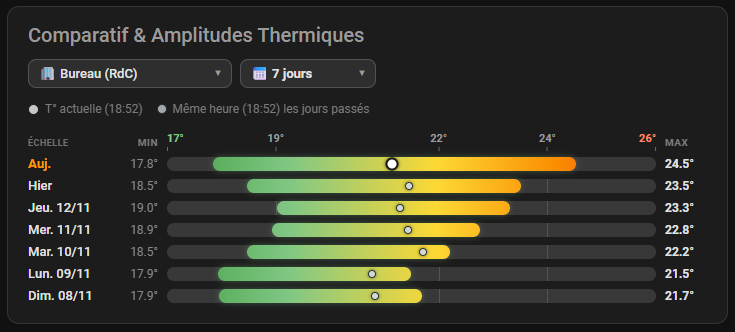
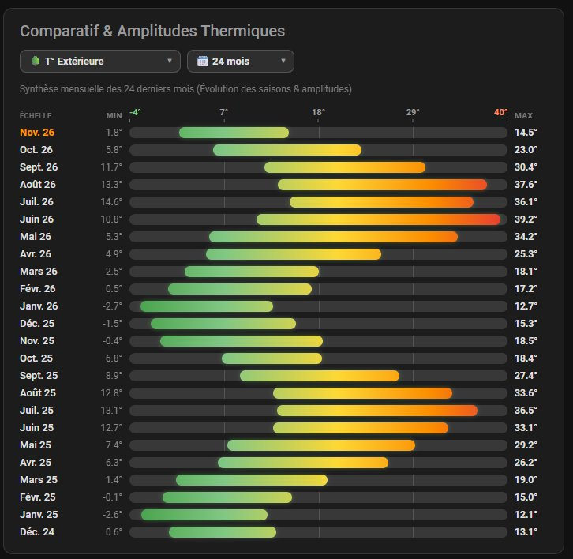

# 🌡️ Temperature History & Range Card for Home Assistant

[](https://github.com/hacs/default)
[](https://github.com/Amapem/temperature-range-card/releases)

A modern, iOS / Apple Weather styled temperature history and range card for Home Assistant. Easily track, compare, and visualize historical temperatures across multiple sensors over flexible periods (days, weeks, or months) with daily/weekly/monthly Min & Max amplitude bars, continuous temperature scale alignment, customizable bar thickness, and a visual UI editor with drag-and-drop reordering.

<p align="center">
  
  <br><br>
  
</p>

---

## Features

- 📊 **Multi-Sensor Temperature History & Trend Analysis**:
  - Easily switch between rooms and sensors (e.g. Living Room, Bedroom, Outdoor) from an interactive dropdown menu.
  - Track thermal minimum, maximum, and amplitude shifts over **days**, **weeks**, or up to **24 months** to observe seasonal waves.
- 🌡️ **Real-Time Current Temperature Badge (`show_current`)**:
  - Optional Apple Weather styled header displaying the current temperature in large typography alongside the card title.
  - Automatically adapts to a clean two-tier responsive layout with dedicated room & period dropdowns.
  - Toggleable on/off directly from the visual Lovelace editor.
- 🌍 **Full Native Multi-Language Support (i18n)**:
  - Automatically localized according to the user's Home Assistant language.
  - 6 languages supported out of the box: **English (`en`)**, **Français (`fr`)**, **Deutsch (`de`)**, **Español (`es`)**, **Italiano (`it`)**, and **Nederlands (`nl`)**.
  - Dynamic localized date formatting for days and months based on user locale.
- 🍏 **Apple Weather Continuous Temperature Gradient**:
  - `gradient_mode: global` (default): Colors map to absolute temperature positions on the scale, ensuring identical colors for the same temperature across all days and seasons.
  - `gradient_mode: local`: Relative gradient spanning each day's individual amplitude from green to red.
- 📏 **Fully Customizable Bar Thickness**:
  - `bar_height`: Adjust track height from `6px` to `60px` (default `18px`). Includes quick presets (`10px`, `14px`, `18px`, `24px`, `28px`, `34px`) and adaptive dot sizing.
- 📐 **Graduated Temperature Scale**: Min, intermediate ticks, and Max markers aligned with discrete vertical guide lines.
- ⏱️ **Dynamic Custom Periods (`<N>d`, `<N>w`, `<N>m`, `<N>y`)**:
  - Days: `1d`, `2d`, `7d`, `10d`, `14d`, `15d`, `30d`...
  - Weeks: `1w`, `2w`, `4w`, `8w`, `10w`, `20w`... (ISO week grouping)
  - Months: `1m`, `3m`, `6m`, `12m`, `24m`... (Multi-month overview)
  - Years: `1y`, `2y`, `3y`, `5y`... (Annual comparison across historical years)
  - Chronological auto-sorting (Days → Weeks → Months → Years).
- 🎛️ **Full Visual UI Editor (Lovelace)**:
  - **Ultra-compact sensor list**: 28px collapsible rows displaying clean custom names.
  - **Native Drag & Drop (`≡`)**: Effortlessly reorder sensors with the drag handle.
  - **Quick Expand/Collapse**: Click any row to unfold details or use "Tout déplier / Tout replier".
  - **Strict Sensor Filter**: Entity picker filters strictly for real temperature sensors (`device_class: temperature` or °C/°F units).
- ⚪ **Reference Temperature Dots**:
  - White dot with dark border for current real-time temperature.
  - Comparison dots for past days at the exact same hour across full recorder retention.
- ⚡ **Zero Dependencies**: Pure Vanilla Web Components, ultra fast and lightweight.

---

## Installation via HACS

1. Open **HACS** in your Home Assistant dashboard.
2. Click the three dots in the top-right corner and select **Custom repositories**.
3. Add the repository URL: `https://github.com/Amapem/temperature-range-card`
4. Set category to **Lovelace (Dashboard)**.
5. Search for **Temperature History & Range Card** and click **Download**.

---

## Configuration

### YAML Example

```yaml
type: custom:temperature-range-card
title: Temperature Overview
default_period: 10d
default_entity: sensor.outdoor_temperature
show_scale: true
gradient_mode: global
bar_height: 18
available_periods:
  - 10d
  - 15d
  - 30d
  - 10w
  - 20w
  - 6m
  - 12m
  - 24m
entities:
  - entity: sensor.outdoor_temperature
    name: 🌳 Outdoor Sensor
  - entity: sensor.living_room_temperature
    name: 🛋️ Living Room
  - entity: sensor.bedroom_temperature
    name: 🛏️ Bedroom
```

---

## Configuration Options

| Parameter | Type | Default | Description |
| :--- | :--- | :--- | :--- |
| `type` | string | **Required** | `custom:temperature-range-card` |
| `entities` | list | `[]` | List of sensor objects (`entity` and `name`) |
| `title` | string | `Amplitudes & Comparatif Journalier` | Header title of the card |
| `default_entity` | string | First entity in list | Entity selected when the card is first loaded |
| `default_period` | string | `10d` | Initial period view (any valid period, e.g. `10d`, `15d`, `20w`, `6m`) |
| `show_scale` | boolean | `true` | Displays the graduated min/intermediate/max temperature scale |
| `show_current` | boolean | `false` | Displays the current real-time temperature badge with a two-tier Apple Weather header layout |
| `gradient_mode` | string | `global` | `global` (Apple Weather continuous scale) or `local` (0%-100% per bar) |
| `bar_height` | number | `18` | Bar thickness in pixels (from 6 to 60 px) |
| `available_periods` | list | `[10d, 20d, 30d, 20w, 12m]` | List of allowed period options (`<N>d`, `<N>w`, `<N>m`) |

---

## Author & License

Created by **Amapem**. Released under the MIT open-source license.
