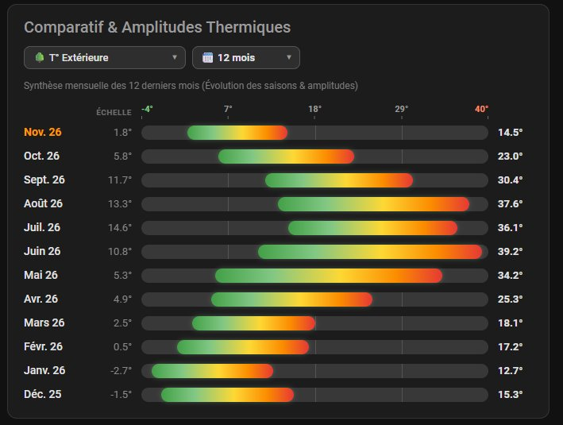

# Temperature Range Card for Home Assistant

A sleek, modern Lovelace card designed to visualize daily, weekly, and monthly temperature amplitudes from your Home Assistant sensors.

<p align="center">
  
</p>

---

## Key Features

* **Real Sensor Amplitudes**: Designed for physical indoor and outdoor temperature sensors (`sensor.*`), not just weather forecasts.
* **Long-Term Statistics Support**: Leverages Home Assistant's native recorder and long-term statistics engine (`statistics_during_period`) across completely custom granularities:
  * 📅 **Flexible Days (`<N>d`)**: `2d`, `7d`, `10d`, `14d`, `15d`, `30d`, `60d`... with live current temperature marker and same-time comparison points for recent days.
  * 🗓️ **Flexible Weeks (`<N>w`)**: `4w`, `8w`, `10w`, `20w`, `52w`... weekly summaries grouped by ISO week numbers.
  * 🗓️ **Flexible Months (`<N>m`)**: `3m`, `6m`, `12m`, `24m`... extended seasonal multi-month analysis.
* **Graduated Temperature Scale**: Top-aligned visual scale showing global min, intermediate reference markers, and global max, with vertical guidelines embedded in each row's track.
* **Interactive Dynamic Selectors**: Switch between sensors and change observation periods directly from the card with automatic local storage persistence.
* **Visual Card Editor**: Complete configuration UI to reorder, add, or remove sensors, adjust default views, add custom period chips, and toggle display options without writing YAML.

---

## Installation

### Via HACS (Custom Repository)

1. Open **HACS** in your Home Assistant dashboard.
2. Click the top-right menu (three dots) and select **Custom repositories**.
3. Enter the repository URL: `https://github.com/Amapem/temperature-range-card`.
4. Select category: **Dashboard** (or **Lovelace**).
5. Click **Add**, find **Temperature Range Card** in the list, and click **Download**.
6. Refresh your browser cache.

### Manual Installation

1. Download `temperature-range-card.js` from the latest release.
2. Place the file inside your Home Assistant config directory at `/config/www/temperature-range-card.js`.
3. Add a Lovelace resource in Home Assistant (**Settings** > **Dashboards** > **Three dots** > **Resources**):
   * URL: `/local/temperature-range-card.js`
   * Resource type: `JavaScript Module`

---

## Dashboard Configuration

### Visual Editor

Add a new card to your dashboard, search for **Temperature Range Card**, and configure your entities and preferences directly from the visual interface.

### YAML Example

```yaml
type: custom:temperature-range-card
title: Temperature Overview
default_period: 10d
default_entity: sensor.outdoor_temperature
show_scale: true
available_periods:
  - 10d
  - 15d
  - 30d
  - 10w
  - 20w
  - 6m
  - 12m
  - 24m
entities:
  - entity: sensor.outdoor_temperature
    name: Outdoor Sensor
  - entity: sensor.living_room_temperature
    name: Living Room
  - entity: sensor.bedroom_temperature
    name: Bedroom
```

---

## Configuration Options

| Parameter | Type | Default | Description |
| :--- | :--- | :--- | :--- |
| `type` | string | **Required** | `custom:temperature-range-card` |
| `entities` | list | **Required** | List of sensor objects (`entity` and `name`) |
| `title` | string | `Amplitudes & Comparatif Journalier` | Header title of the card |
| `default_entity` | string | First entity in list | Entity selected when the card is first loaded |
| `default_period` | string | `10d` | Initial period view (any valid period, e.g. `10d`, `15d`, `20w`, `6m`) |
| `show_scale` | boolean | `true` | Displays the graduated min/intermediate/max temperature scale |
| `available_periods` | list | `[10d, 20d, 30d, 20w, 12m]` | List of allowed period options in dropdown (`<N>d`, `<N>w`, `<N>m`) |

---

## Author & License

Created by **Amapem**. Released under the MIT open-source license.
